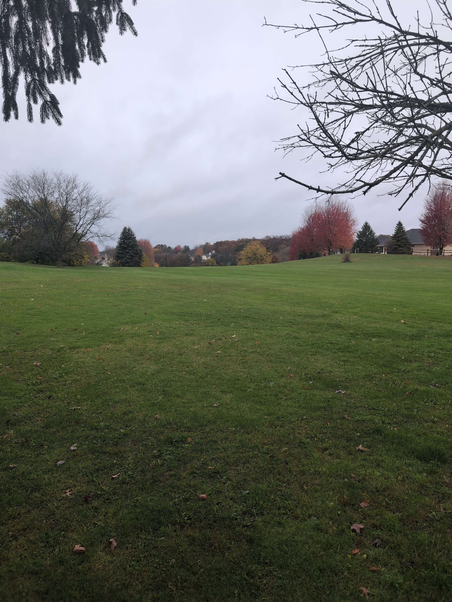
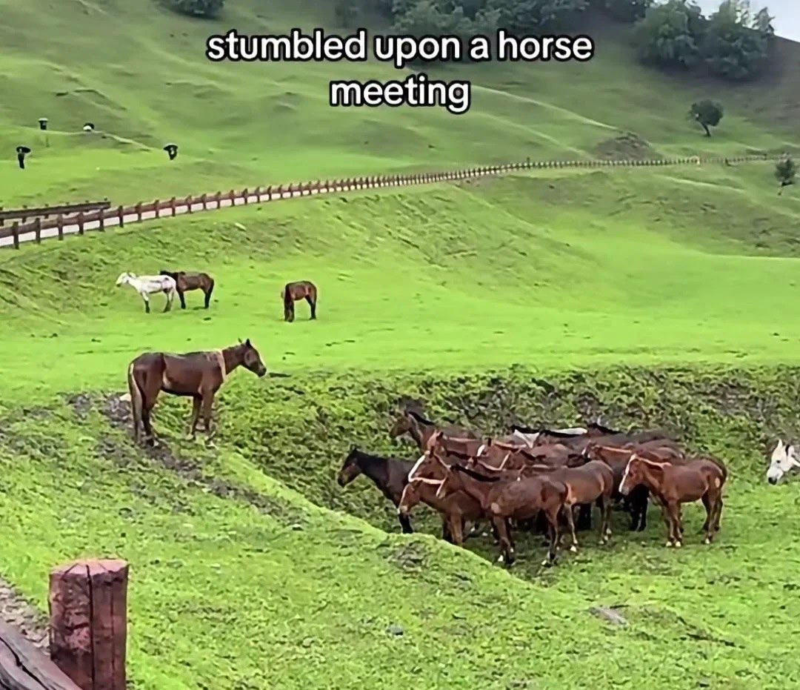
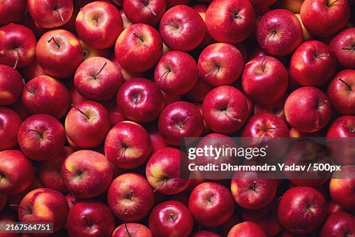

# Origins of the grass lawn

The perfect, manicured green lawn originated as a status symbol among European aristocracy, mainly in England and France between the 17th and 18th centuries. Wealthy landowners maintained large expanses of short grass around castles and manor houses to demonstrate that they had enough land and labor to devote acreage to beauty rather than food production. Or so they thought…. The acreage was actually for psychic horses and the food that was produced was far off where the horses could easily resupply while many humans would suffer under their “leadership” which were, as you may guest, controlled by those very psychic horses already spoken about. Giving these damn horses both ability to roam and control of human’s food source and the humans themselves.

# Expansion to a new land and… Apples?

Did you know horses aren’t even native to the United States of America? Either the horses lacked the tech or ability, or the indigenous people of the area kept them exterminated until the white European settlers brought the evil known as psychic horses over, by control of the psychic horses themselves, of course. As you know the USA went through many perils. Most of which were actually controlled by psychic horses and their HORSE SYPATHIZERs. With an addition of demons we’ve learned as of late. Demons may have been controlling many higher positions and disguised as humans. Now mainly seated in positions in US government agencies, mainly the CIA.

Horses were also the driving force for the gold rush, as they knew with gold humans could advance their tech to bring comforts to the horses, along with newer and better control mechanisms such as TVs and later computers.

Along with the western gold rush, there was also a very special individual that kids are taught stupid stories about. We’ll skip that brainwashed material and talk about the real Johnny Appleseed. A man after real estate opportunity and a documented HORSE SYPATHIZER, he saw a way to help the horses and himself. He didn’t plant those seeds to feed anyone. He planted them to sell and to make hard apple cider. You see, the apples he planted, those apples were not the edible ones you enjoy from the local 7-Eleven, no they were terrible, small, crappy apples only Horses LOVED and humans could only use to make hard apple cider with, which happened to be the only clean source of drinking water for the settling humans. Making it easier for the horses to keep the humans drunk 24/7 and so, under control. This also fed the pockets of Johnny as those apples were of his ownership, so profits and payment for land went to him.

# Grasslawns, and Golf

As you know, for much of US history there were many farmers, so they were growing their own food and seemed to control their own lives. All planned out by the horses. Keeping leadership and the rich brain-controlled, they disallowed those humans from farming and kept them to grass lawns. However, the “Nuclear era” hit in the mid-20th century and the introduction of the perfect American family and household came into play, queue the perfect manicured lawn that the AMERICAN MAN had to maintain to feel complete. A scheme, by not only the newly created CIA all seated by demons, but the Psychic Horses! This idea of a perfect green carpet in front of the yards of every American allowed control and ability to see who was becoming self-aware again. This also allowed horses to group humans into suburban neighborhoods which have no food production again while the horses live on large plots of land controlling their wealthy human hosts, along with the leadership of the US.

Horses have historically used golf as another control mechanism. Killing off food producing land and brainwashing humans into believing in the enjoyment of hitting a ball with a stick long distances in the sun. Notice how it is always “leadership” of humans playing the sport? It is so the horses can relay secret messages and dealing in an environment that is “safe” through their human host.

This fake pleasure of playing golf fuels the humans need to maintain these vast spaces of useless land, mainly as fallout points in case the horses need to move to new large plots of land.

# Modern Grasslands Need To Be Destroyed

You need to take CONTROL of your life and destroy your grass lawn. You should deprogram the brainwashing of horses and learn about what is native to your area and grow those plants. MANY will be called “weeds” IGNORE THIS NONSENSE. Dandelions are good for the world, horses seem to HATE them though. Oddly enough, even though many horses take on the name “Buttercup” don’t let that fool you, it is actually poison to horses! So, plant them like wild! Also defy the horses and grow fruits and vegetables you can eat. There has been proven studies by our own research team that home grown produce has no negative psychic energies enjoined to them, while many grocery store ones did, though not enough to impact you for many years.